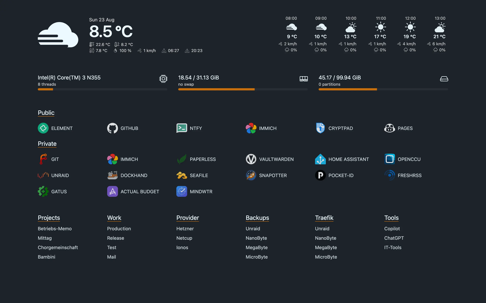
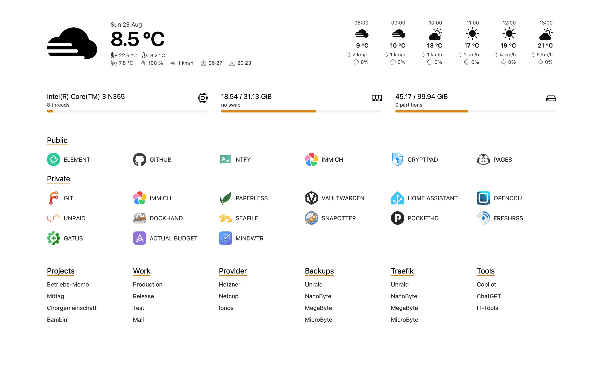

<div align="center">

[](https://github.com/flohoss/godash/actions/workflows/ci.yaml)
[](https://github.com/flohoss/godash/wiki/coverage.html)

A self-hosted dashboard written in Go. See the weather forecast, monitor system resources in real time, and keep your bookmarks with icons and links in one place — all driven by a single YAML config file.

</div>

## Table of Contents

- [Quick Start](#quick-start)
- [Features](#features)
- [Configuration](#configuration)
  - [Environment overrides](#environment-overrides-gd_)
  - [Top-level settings](#top-level-settings)
  - [Weather](#weather)
  - [Single sign-on (OIDC)](#single-sign-on-oidc)
  - [Applications](#applications)
  - [Links](#links)
  - [Icons](#icons)
- [Screenshots](#screenshots)
- [Development](#development)
- [License](#license)

## Quick Start

Just run the container — GoDash creates a default `config.yaml` with example data on first start if none exists:

```sh
docker run -it --rm \
  --name godash \
  -p 8156:8156 \
  -v ./config/:/app/config/ \
  ghcr.io/flohoss/godash:latest
```

Open <http://localhost:8156> to see your dashboard. Edit `./config/config.yaml` to add bookmarks or set your location — changes are picked up automatically (no restart needed).

Or with Docker Compose:

```yml
services:
  godash:
    image: ghcr.io/flohoss/godash:latest
    restart: always
    ports:
      - '8156:8156'
    volumes:
      - ./config/:/app/config/
```

The container runs as an unprivileged user (`PUID`/`PGID`, defaults to `1000:1000`) and exposes the dashboard on port `8156`.

## Features

- **Weather** — current conditions and an hourly forecast, pulled from [Open-Meteo](https://open-meteo.com/) with no API key required. Choose between Celsius and Fahrenheit.
- **Realtime system status** — CPU, RAM, and disk usage streamed live to the browser over Server-Sent Events (SSE).
- **Bookmarks** — applications and links organized into categories, each with a name, optional icon, and URL.
- **Dark / light icons** — each bookmark can have both a dark and a light icon, automatically picked based on the active theme.
- **Single config file** — everything is defined in `config.yaml`, validated at startup and hot-reloaded on change.
- **Optional single sign-on** — protect the dashboard with any OpenID Connect provider. See [Single sign-on (OIDC)](#single-sign-on-oidc).
- **Lightweight & easy to deploy** — a single static binary served from a minimal Alpine container.

## Configuration

GoDash reads `./config/config.yaml` by default and creates one with example values on first run. The full default config lives in [`config/config.yaml`](config/config.yaml).

```yaml
log_level: 'info' # debug | info | warn | error
time_zone: 'Europe/Berlin' # Must be a valid IANA timezone (e.g., America/New_York, Europe/London)
title: 'My Dashboard' # Any string

server:
  address: '0.0.0.0' # Valid IPv4 address, defaults to 0.0.0.0
  port: 8156 # Must be between 1024 and 65535, defaults to 8156
  trusted_proxies: [] # CIDRs of proxies whose X-Forwarded-For may be trusted, empty means direct connections only

weather:
  units: 'celsius' # celsius | fahrenheit
  latitude: 52.5163 # Valid latitude (-90 to 90)
  longitude: 13.3776 # Valid longitude (-180 to 180)

auth:
  oidc:
    enabled: false # Set to true to require a login for the dashboard
    issuer_url: '' # Provider issuer, must match the `iss` claim exactly, no trailing /
    client_id: ''
    client_secret: ''
    session_key: '' # At least 32 characters, signs the session cookie
    session_ttl: '24h' # How long a login stays valid
    cookie_secure: false # Set to true when served over HTTPS

applications:
  - category: 'Productivity'
    entries:
      - name: 'Notion'
        icon: 'notion.png'
        ignore_dark: false # Keep using the same icon even if a light variant exists
        url: 'https://www.notion.so'
      - name: 'Slack'
        icon: 'sh/slack' # Automatically downloaded from selfh.st
        ignore_dark: true
        url: 'https://slack.com'

links:
  - category: 'Social'
    entries:
      - name: 'GitHub'
        url: 'https://github.com'
```

### Top-level settings

| Field       | Required | Description                                                                       |
| ----------- | -------- | --------------------------------------------------------------------------------- |
| `log_level` | no       | Log verbosity. `debug` \| `info` \| `warn` \| `error`.                            |
| `time_zone` | no       | IANA timezone used for weather and displayed times.                               |
| `title`     | no       | Dashboard title shown in the header and browser tab.                              |
| `server`    | no       | Bind address and port. `address` must be a valid IPv4, `port` between 1024–65535. |
| `auth`      | no       | Optional single sign-on. See [Single sign-on (OIDC)](#single-sign-on-oidc).       |

### Environment overrides (`GD_`)

Any config value can be overridden with an environment variable prefixed `GD_`. Dots become underscores and keys are uppercased.

- `GD_TITLE='My Dash'` overrides `title`
- `GD_SERVER_PORT=9000` overrides `server.port`
- `GD_AUTH_OIDC_CLIENT_SECRET=...` overrides `auth.oidc.client_secret`

### Reverse proxies

The client IP decides the per-IP SSE connection limit, so the `X-Forwarded-For` header is only honoured when the connecting peer is listed in `server.trusted_proxies`. Behind a reverse proxy, list the proxy's networks there to have the forwarded client address used instead:

```yaml
server:
  address: '0.0.0.0'
  port: 8156
  trusted_proxies:
    - '10.0.0.0/8'
    - 'fd00::/8'
```

Each entry must be a valid CIDR. Loopback, link-local, and private networks are never trusted implicitly, so the header is ignored unless the connecting proxy is listed. With an empty list the header is ignored entirely — the direct connection address is used, which is safest when GoDash is exposed directly.

### Weather

| Field       | Description                                       |
| ----------- | ------------------------------------------------- |
| `units`     | `celsius` or `fahrenheit`. Defaults to `celsius`. |
| `latitude`  | Latitude of the forecast location (-90 to 90).    |
| `longitude` | Longitude of the forecast location (-180 to 180). |

### Single sign-on (OIDC)

GoDash can require a login for the entire dashboard using any OpenID Connect provider, and is tested against [Pocket-ID](https://github.com/pocket-id/pocket-id).

Set up:

1. Create an OIDC client in your provider. Its callback URL is the address you open GoDash with, followed by `/auth/callback` — `https://godash.example.com/auth/callback`, or with the port when nothing terminates TLS on 443: `https://godash.example.com:8156/auth/callback`.
2. Copy the client ID and secret the provider generates.
3. Generate a `session_key` of at least 32 characters (e.g. `openssl rand -hex 32`).
4. Enable it in the config:

```yaml
auth:
  oidc:
    enabled: true
    issuer_url: 'https://id.example.com'
    client_id: 'godash'
    client_secret: 'change-me'
    session_key: 'a-sufficiently-long-session-signing-key'
```

| Setting                       | Default | Description                                                                                                                                        |
| ----------------------------- | ------- | -------------------------------------------------------------------------------------------------------------------------------------------------- |
| `enabled`                     | `false` | Require a login for the dashboard.                                                                                                                 |
| `issuer_url`                  | —       | The provider's issuer. Must match the `iss` claim exactly, with no trailing `/`.                                                                   |
| `client_id` / `client_secret` | —       | Credentials issued by the provider.                                                                                                                |
| `session_key`                 | —       | At least 32 characters, used to sign the session cookie. Rotating it invalidates all existing sessions. Required when `enabled`.                   |
| `session_ttl`                 | `24h`   | How long a login stays valid.                                                                                                                      |
| `cookie_secure`               | `false` | Set to `true` when GoDash is served over HTTPS. Left `false` over HTTPS, the browser drops the session cookie and bounces you back to the provider. |

**Discovery** — The authorization, token, and JWKS endpoints come from the provider's `.well-known/openid-configuration`, so only the issuer needs configuring. Discovery is warmed in the background at startup, so the first login does not wait for the round trip, and bounded by a 10 second timeout. An unreachable provider is retried on the next login attempt — failures are never cached, so a provider that recovers needs no restart — and a login during the outage fails with `503 Service Unavailable` rather than `401`, so it is not mistaken for bad credentials.

**Login flow** — Authorization code grant with PKCE and `state`. Unauthenticated requests are redirected straight to the provider; there is no separate login page. The provider returns to `/auth/callback`, which sets a signed session cookie and redirects to the dashboard. Only the `openid` scope is requested, and the session is keyed on the ID token's `sub` claim, so GoDash never needs the user's email address.

**Sessions** — The session cookie is stateless: an HMAC-signed payload of the subject and expiry, verified on every request without a database lookup. It is renewed automatically once it passes half its lifetime, so a user who loads the dashboard regularly stays logged in; a user who stays away longer than `session_ttl` has to sign in again. Signed with `session_key`, so changing that key signs everyone out. There is no logout — sessions expire on their own; to invalidate every session early, rotate `session_key`.

Every setting, including `enabled`, applies on config reload without a restart; changing `issuer_url` or `client_id` re-runs discovery on the next login.

Use `GD_AUTH_OIDC_CLIENT_SECRET` and `GD_AUTH_OIDC_SESSION_KEY` to keep secrets out of the config file.

### Applications

Applications are grouped into categories. Each entry can show an icon, name, and link:

| Field         | Required | Description                                                                 |
| ------------- | -------- | --------------------------------------------------------------------------- |
| `name`        | yes      | Display name shown under the icon.                                          |
| `icon`        | no       | Icon file name, path, or a `sh/`-prefixed self-hosted icon.                 |
| `url`         | no       | Link target. Must be a valid URL.                                           |
| `ignore_dark` | no       | Keep using the light icon even when a dark variant exists. Default `false`. |

### Links

Simple text bookmarks grouped into categories, without icons:

| Field      | Required | Description                           |
| ---------- | -------- | ------------------------------------- |
| `category` | no       | Grouping label for a set of links.    |
| `name`     | yes      | Link label.                           |
| `url`      | no       | Destination URL. Must be a valid URL. |

### Icons

Icons can be provided in any of three ways:

- **`sh/` prefix** — downloaded automatically from [selfh.st/icons](https://selfh.st/icons/) (e.g. `sh/slack`) and cached locally.
- **Local file** — a file name or path such as `notion.png`, resolved from the `icons` folder.
- **External URL** — a full URL, served directly without caching.

GoDash can store both a **dark** and a **light** variant of each icon. When both exist, the correct one is shown based on the active theme unless `ignore_dark` is set. Orphaned icons (no longer referenced) are cleaned up automatically when the config reloads.

## Screenshots

### Dark mode

<p align="center">
  
</p>

### Light mode

<p align="center">
  
</p>

## Development

All development workflows — dev server, formatting, tests, and dependency updates — are documented in [`AGENTS.md`](AGENTS.md).

## License

This project is licensed under the MIT License — see the [LICENSE](LICENSE) file for details.
